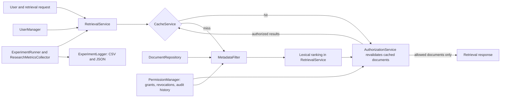
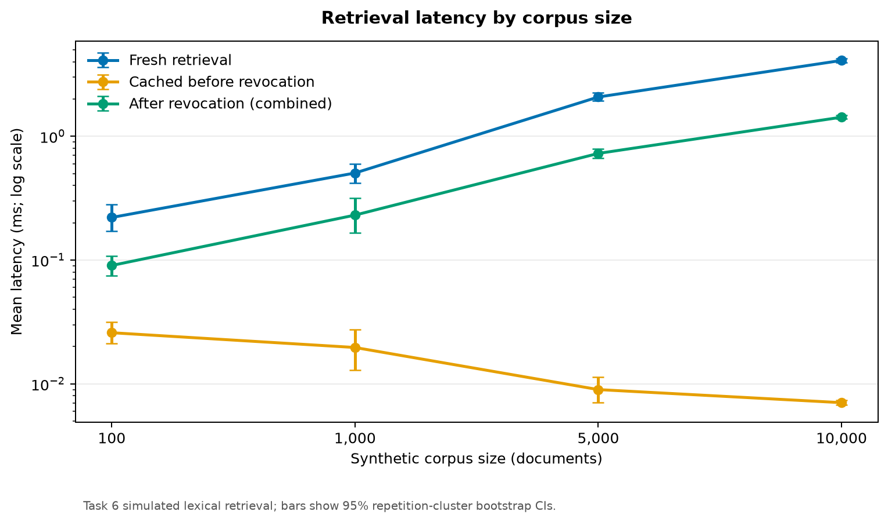
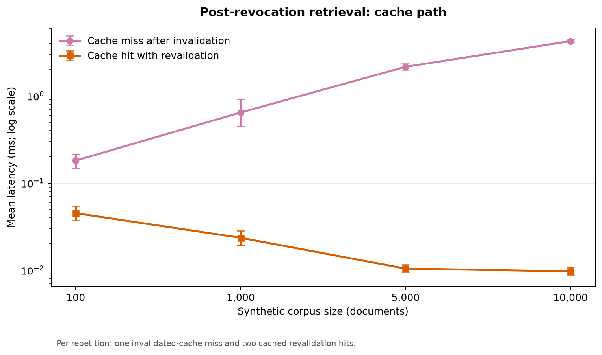
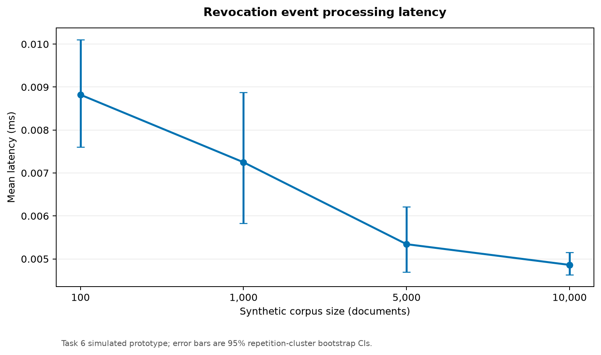
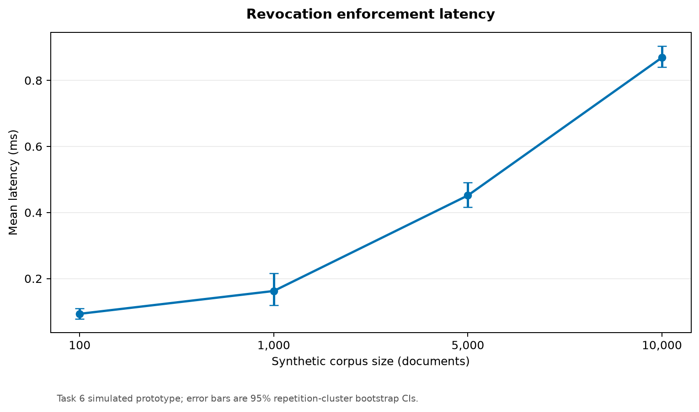
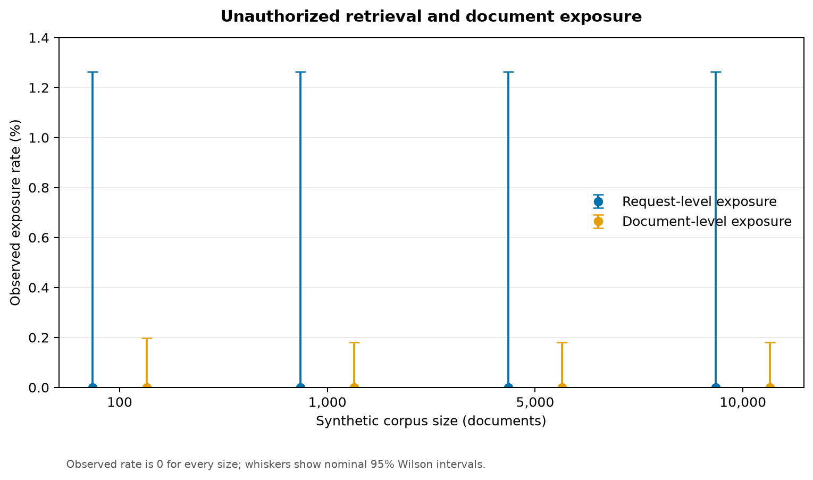
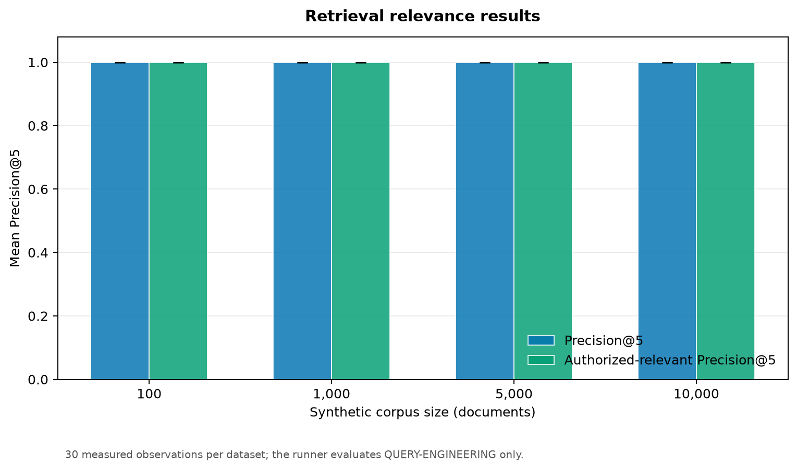

# Revocation-Aware Dynamic Access Control for Retrieval-Augmented Generation Systems Using Metadata-Based Authorization

> **Research prototype:** this repository evaluates authorization and revocation behavior around a simulated retrieval layer. It is not a complete production RAG system and has no vector database, embedding model, or LLM integration.

## Overview

This Java prototype studies whether access decisions remain current when user or role permissions change, including when a previously authorized document is already in a retrieval cache. The implementation combines role and attribute checks, explicit permission state, metadata filtering, document-level cache revalidation, an audit trail, and reproducible synthetic experiments.

The measured results are limited to the local, in-memory lexical implementation and fixed synthetic inputs in this repository. They do not measure production-scale RAG performance, model behavior, or prompt leakage.

## Research motivation and problem

RAG applications retrieve documents before generating an answer. If access is revoked after retrieval, a stale cached result can remain available unless the system rechecks current authorization before returning it. This project examines the retrieval and cache boundary: whether revoked documents are omitted from subsequent responses, and what the prototype’s measured latency and exposure metrics show.

## Research objectives

- Enforce current user, role, department, clearance, and explicit permission state during retrieval.
- Record permission changes and measure revocation processing and enforcement timing.
- Revalidate cached documents rather than trusting the authorization decision made when they were first cached.
- Evaluate exposure, retrieval latency, event outcomes, and relevance using seeded synthetic datasets.
- Preserve raw observations and reproducibility metadata for analysis.

## Prototype contributions

- In-memory Java components for user management, permission state, authorization, metadata filtering, lexical retrieval, and cache revalidation.
- Grant/revoke audit records and CSV/JSON experiment exports.
- Baseline revocation scenarios and a repeated seven-scenario Task 6 evaluation over four dataset sizes.
- Deterministic datasets with explicit topic-based relevance labels, plus Task 7 statistical analysis and graphing scripts.

These are implementation and evaluation contributions of a prototype; the repository does not establish a general solution or production guarantee.

## System architecture



| Component | Implemented responsibility |
| --- | --- |
| `UserManager` | Holds user identities, active status, roles, department, and clearance. |
| `PermissionManager` | Holds explicit user/role grants and revocations, resolves current state, and records permission audit history. |
| `AuthorizationService` | Evaluates current permission and document attributes, including explicit revocation, clearance, department, and allowed roles. |
| `MetadataFilter` | Filters candidate documents using user/document metadata before ranking. |
| `DocumentRepository` | In-memory document store; it does not connect to a vector database. |
| `RetrievalService` | Handles identity lookup, cache lookup, metadata filtering, lexical ranking, final authorization, and result caching. |
| `CacheService` | Stores query results and revalidates each cached document through the authorization service before returning it. |
| `ExperimentRunner` / `ExperimentLogger` | Runs the baseline and revocation scenarios and exports results. |
| `RepeatedExperimentRunner` / `RepeatedExperimentLogger` | Runs the seeded, repeated Task 6 dataset evaluation and exports raw observations, aggregates, and metadata. |
| `SyntheticDatasetGenerator` | Creates the fixed-seed synthetic corpora, users, queries, and permission-independent topic labels. |

## Authorization and permission workflow

The authorization service checks user activity and document validity, then applies explicit user revocation and role-revocation checks, classification clearance, department, direct user grants, and allowed roles. If no applicable grant authorizes access, the default is deny. A newer explicit grant or revocation replaces the prior state for that user/resource pair, and grant/revoke transitions are written to the in-memory audit history.

**Policy detail to note:** clearance cannot be bypassed by a direct grant. In `AuthorizationService`, however, a direct user grant or a document’s `allowedUsers` metadata can bypass a department mismatch. The retrieval miss path also applies `MetadataFilter` before ranking. Thus, department behavior is not equivalent to an unconditional mandatory boundary in every code path; consult the implementation and tests when changing policy.

### Permission grant and revocation

`PermissionManager` tracks user- and role-level permission state. Granting or revoking access updates the current state and records the principal, target document, action, timestamp, and previous/updated states in an audit record. Task 1 added CSV/JSON audit exports. These records are process-local; there is no durable audit database or distributed event service.

### Retrieval workflow

1. `RetrievalService` resolves the current active user.
2. It checks a cache entry keyed by user and normalized query.
3. On a miss, the repository’s documents pass through `MetadataFilter`.
4. Candidate documents are scored by query-token substring matches in title and content (title matches receive more weight).
5. The top-ranked candidates undergo final authorization before results are returned and cached.

The ranking is lexical. There is no embedding generation, vector similarity search, semantic reranking, or LLM answer generation in this project.

### Cache revalidation and revocation enforcement

On a cache hit, `CacheService` evaluates cached documents against current authorization rather than returning the old list as-is. Documents no longer authorized are filtered from the response. The Task 6 cached-revocation and multi-document revalidation scenarios exercise this behavior; the experiment measures retrieval-response exposure only, not whether an LLM prompt would leak content.

## Technology stack

- Java 21
- Maven
- JUnit 5
- Jackson 2.17.2 for JSON serialization
- Python 3 and Matplotlib for README figures

## Project structure

```text
.
├── PROJECT_BRIEF.md
├── ANTIGRAVITY_RULES.md
├── TASK_LOG.md
├── pom.xml
├── run-experiments.sh
├── datasets/
│   └── generated/                 # Four seeded synthetic dataset JSON files
├── results/
│   ├── experiment_results.*       # Baseline scenario results
│   ├── *metrics* / *summary*      # Audit and research-metric exports
│   ├── task6/                     # Repeated raw observations, aggregates, metadata
│   └── task7/                     # Statistical analysis and comparison tables
├── assets/
│   └── graphs/                    # README figures generated from Task 6 data
├── scripts/
│   ├── analyze_task7.py
│   ├── test_analyze_task7.py
│   └── generate_readme_graphs.py
└── src/
    ├── main/java/edu/academic/rag/accesscontrol/
    │   ├── dataset/               # Synthetic dataset generation, loading, evaluation
    │   ├── experiment/            # Baseline/repeated runners, metrics, loggers
    │   ├── manager/               # User and permission managers
    │   ├── model/                 # Users, documents, decisions, permission/audit records
    │   ├── repository/             # In-memory document repository
    │   └── service/                # Authorization, filtering, cache, retrieval
    └── test/java/edu/academic/rag/accesscontrol/
        └── ...                     # JUnit 5 component and experiment tests
```

## Dataset and experimental methodology

Four generated datasets contain **100, 1,000, 5,000, and 10,000 documents**. Task 6 used seed `20261117`, six generated users, and six predefined queries. Each dataset was run for 30 measured repetitions with one separate warm-up repetition; warm-up observations are excluded from reported aggregates.

Each measured repetition includes seven scenarios:

1. Authorized retrieval.
2. Unauthorized retrieval attempt.
3. Fresh retrieval followed by revocation.
4. Cached retrieval followed by revocation.
5. Multi-document cache revalidation after selected revocations.
6. Revocation event processing, including a duplicate request.
7. Precision@5 evaluation.

Relevance labels are generated from topic-ID equality, not authorization metadata. Although six queries and label sets are stored, the Task 6 Precision@5 scenario evaluates only `QUERY-ENGINEERING`. The full raw observations are in `results/task6/repeated_experiment_raw.json` and `.csv`; aggregates and configuration are in `results/task6/repeated_experiment_summary.json` and `reproducibility_metadata.json`.

Retrieval/event-processing durations use `System.nanoTime`; revocation enforcement latency is measured from the recorded permission commit to the first subsequent denied response timestamp. Task 7 reports descriptive statistics, nearest-rank P95/P99, repetition-cluster bootstrap intervals for latency/precision, and Wilson intervals for observed rates. It documents the binomial independence assumption and the clustering caveat.

## Evaluation metrics

- **Request-level unauthorized retrieval rate:** requests returning one or more unauthorized documents divided by all measured requests.
- **Document-level unauthorized exposure rate:** unauthorized returned-document observations divided by all returned-document observations.
- **Revocation event outcomes:** processed, duplicate-recognized, and failed events are reported separately. Task 6 counts both processed events and recognized duplicates as successfully handled.
- **Latency:** fresh, cached-before-revocation, post-revocation, event-processing, and revocation-enforcement observations; summaries include mean, median, sample standard deviation, min/max, P95/P99, and confidence intervals.
- **Precision@5:** fraction of the top five judged relevant by the topic labels.
- **Authorized-relevant Precision@5:** relevant top-five documents that also pass authorization, divided by K=5.

## Experimental results

The baseline runner’s stored `results/experiment_results.json` contains **9/9 passing scenarios** (TC-1–TC-6 and RC-1–RC-3). Task 6 completed **120 measured dataset-level repetitions**, **840 measured scenarios**, and **28 warm-up scenarios**; all measured scenarios passed.

| Dataset documents | Fresh mean (ms) | Cached mean (ms) | Post-revocation mean (ms) | Event-processing mean (ms) | Enforcement mean (ms) |
| ---: | ---: | ---: | ---: | ---: | ---: |
| 100 | 0.2208 | 0.0259 | 0.0904 | 0.0088 | 0.0932 |
| 1,000 | 0.5047 | 0.0197 | 0.2307 | 0.0072 | 0.1624 |
| 5,000 | 2.0747 | 0.0090 | 0.7264 | 0.0053 | 0.4516 |
| 10,000 | 4.0947 | 0.0070 | 1.4249 | 0.0049 | 0.8690 |

Across measured Task 6 observations, request exposure was **0/1,200** and document exposure was **0/8,340**. There were 840 revocation-event observations: 720 newly processed, 120 recognized duplicates, and zero failures. The event-handling rate is 100% when recognized duplicates count as successfully handled; it does not mean 840 distinct state changes. Precision@5 and authorized-relevant Precision@5 were both 1.0 for all 120 measured observations, but each used the same engineering query. See the [Task 7 analysis](results/task7/research_analysis.md) for confidence intervals, medians, tails, cache-path separation, and interpretation.

These are measured prototype results for one local synthetic run, not real-world RAG performance. In particular, combined post-revocation latency includes both cache misses after invalidation and cache hits with revalidation; its mean is not a pure cache-revalidation cost.

## Graphs and visualizations

All figures below are generated from the checked-in Task 6 observations; latency error bars use the Task 7 repetition-cluster bootstrap intervals. The unauthorized-rate figure shows observed zero rates with nominal Wilson intervals. Values are from a simulated lexical prototype.

### Retrieval latency



### Post-revocation cache paths



### Revocation processing and enforcement





### Security exposure



### Retrieval relevance



## Installation and execution

### Prerequisites

- JDK 21
- Maven
- Python 3 and Matplotlib only if regenerating the figures

### Build and tests

From the repository root:

```bash
mvn test
```

The Task 7 analysis tests use Python’s standard library:

```bash
python3 -m unittest discover -s scripts -p 'test_*.py' -v
```

### Run the baseline experiments

```bash
./run-experiments.sh
```

This script compiles with Maven’s offline mode and runs `ExperimentRunner`. It writes baseline CSV/JSON results under `results/`. `mvn test` also runs `ExperimentTest`, which invokes the baseline runner; back up any generated results you need to preserve before running either command.

### Regenerate the Task 6 repeated evaluation

The repeated runner accepts dataset and output directory arguments. The following Linux/macOS shell commands use the Jackson versions declared in `pom.xml`:

```bash
mvn -q test-compile
JACKSON="$HOME/.m2/repository/com/fasterxml/jackson"
CLASSPATH="target/classes:$JACKSON/core/jackson-databind/2.17.2/jackson-databind-2.17.2.jar:$JACKSON/core/jackson-core/2.17.2/jackson-core-2.17.2.jar:$JACKSON/core/jackson-annotations/2.17.2/jackson-annotations-2.17.2.jar:$JACKSON/datatype/jackson-datatype-jsr310/2.17.2/jackson-datatype-jsr310-2.17.2.jar"
java -cp "$CLASSPATH" edu.academic.rag.accesscontrol.experiment.RepeatedExperimentRunner datasets/generated results/task6
```

**This reruns the experiment and overwrites files in `results/task6/`.** Do not run it if you need to preserve the checked-in observations.

### Reproduce analysis and figures

Task 7 analysis uses only Python’s standard library:

```bash
python3 scripts/analyze_task7.py
```

To regenerate the README figures, install Matplotlib in a virtual environment and run:

```bash
python3 -m venv .venv
. .venv/bin/activate
python -m pip install matplotlib
python scripts/generate_readme_graphs.py
```

The graph script reads Task 6 and Task 7 exports and writes only to `assets/graphs/`.

## Limitations

- This is a Java security/retrieval prototype, not an end-to-end RAG application.
- Documents and queries are synthetic, fixed-seed, and highly templated; the exact-topic relevance rule yields an easy lexical task. Only one of the six queries is used for Task 6 Precision@5.
- Retrieval is an in-memory lexical scan; there is no vector index, embedding model, external corpus, LLM, or prompt-leakage experiment.
- Experiments are single-process and local. They do not model production concurrency, distributed caches, network/storage delays, asynchronous event queues, or durable audit storage.
- Zero observed exposures in a finite experiment is not proof of zero risk. Confidence intervals and assumptions are documented in Task 7; no significance or causal claims are made.
- The department exception for explicit user grants described above should be reviewed against any policy that requires strict department boundaries.

## Future work

- Evaluate realistic, permission-independent relevance judgments across all queries, including ambiguous queries and hard negative documents.
- Integrate a vector database and embedding retrieval behind the existing authorization boundary, then evaluate cache and policy behavior under controlled load.
- Study concurrent revocation, distributed caches, durable audit/event processing, and end-to-end latency.
- Extend exposure evaluation to prompt assembly and LLM integration without treating retrieval-only measurements as prompt-leakage evidence.
- Clarify and test whether explicit grants may override department boundaries in the intended policy.

## Research references

No external papers or standards are currently documented as project references. This README cites the repository’s implementation, raw experiment outputs, and generated analysis rather than introducing unverified citations.
